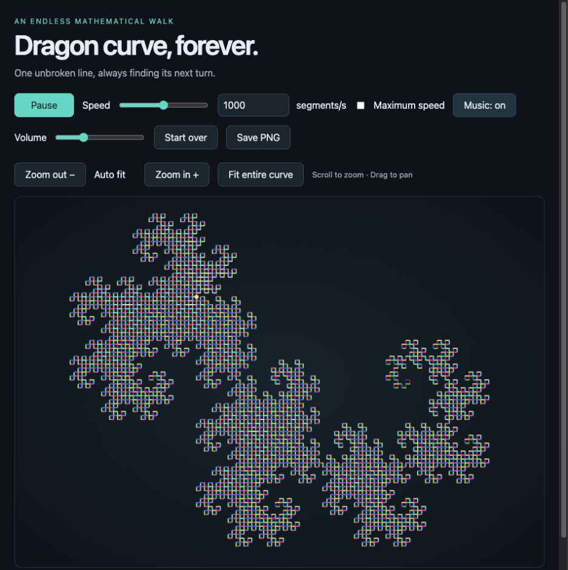

# Dragon Curve, Forever

An interactive Heighway dragon curve that keeps drawing while the page is open. Built with plain HTML, CSS, JavaScript, Canvas 2D, and Web Audio. No build tools, dependencies, accounts, or external assets are needed.



## Run locally

Open `index.html` directly in a modern browser, or serve this directory with Python:

```sh
python3 -m http.server 8765 --bind 127.0.0.1
```

Then visit <http://127.0.0.1:8765/>.

## Controls

- **Pause / Resume:** stop or continue drawing.
- **Speed:** drag the slider or enter a positive whole number of segments per second. The number field accepts rates beyond the slider's range; actual throughput depends on the browser.
- **Maximum speed:** draw at available browser throughput rather than a fixed target rate.
- **Zoom in / Zoom out:** explore the curve without removing segments.
- **Scroll / Drag:** zoom around the cursor and pan the view.
- **Fit entire curve:** return to automatic framing as the curve grows.
- **Music:** enable a synthesized ambient soundtrack. Browsers require a user gesture to start audio; use the volume slider to adjust it.
- **Save PNG:** download the current viewport as an image.
- **Start over:** clear the drawing and begin a new curve.

## How it works

The program generates right-angle turns from the regular paper-folding sequence. A `BigInt` step counter keeps the turn index exact. Each new fold is a reversed, rotated copy of the preceding curve. Segment colors follow their fold ancestry: each rotated copy receives a new rainbow hue and higher HSL lightness than its source.

All generated coordinates and drawing paths remain in memory until **Start over**, a page reload, or closing the tab. Cached `Path2D` batches avoid rebuilding earlier geometry on each frame. Automatic framing fits the full curve; manual zoom and pan let you inspect smaller regions.

The soundtrack uses locally generated oscillators and envelopes through the Web Audio API. It does not download or stream music.

## Practical limits

The sequence has no fixed iteration limit, but a browser has finite memory and rendering capacity. Preserving every segment means memory use and redraw cost grow over time. Very long runs or maximum-speed drawing may slow down the page. Drawing state is not saved across reloads. PNG exports capture the viewport at its current resolution.

## Files

- `index.html` — complete application, styles, and soundtrack.
- `docs/preview.png` — preview image.
- `README.md` — setup, controls, and implementation notes.
